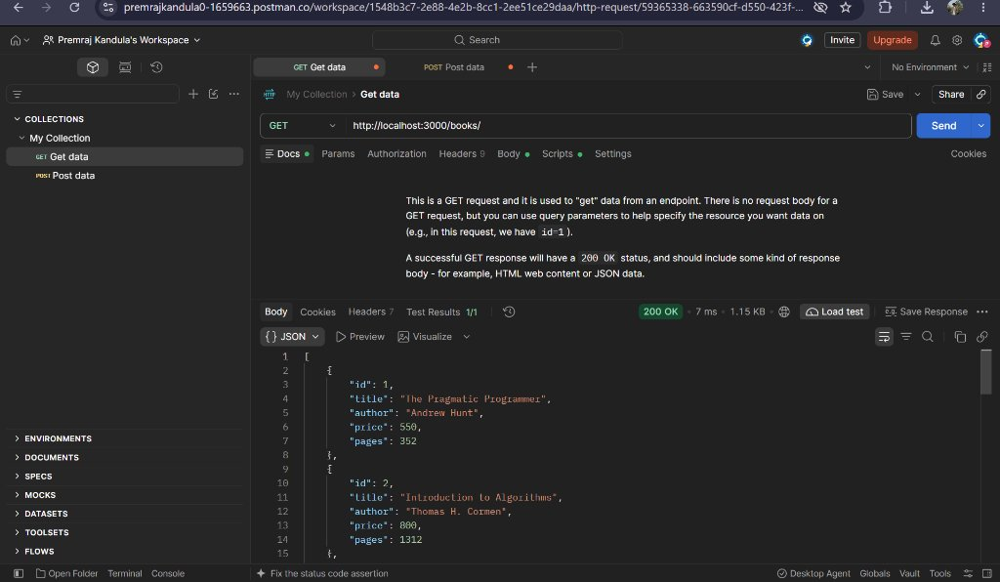
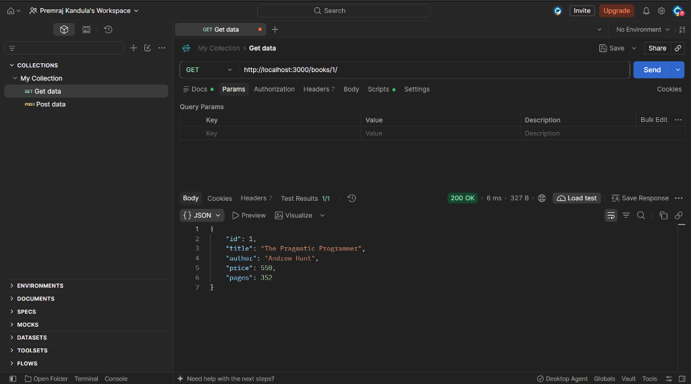
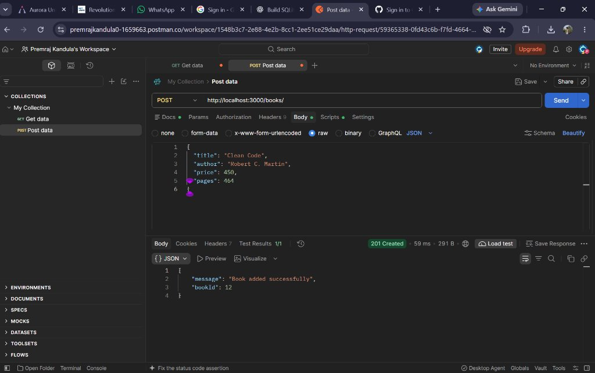
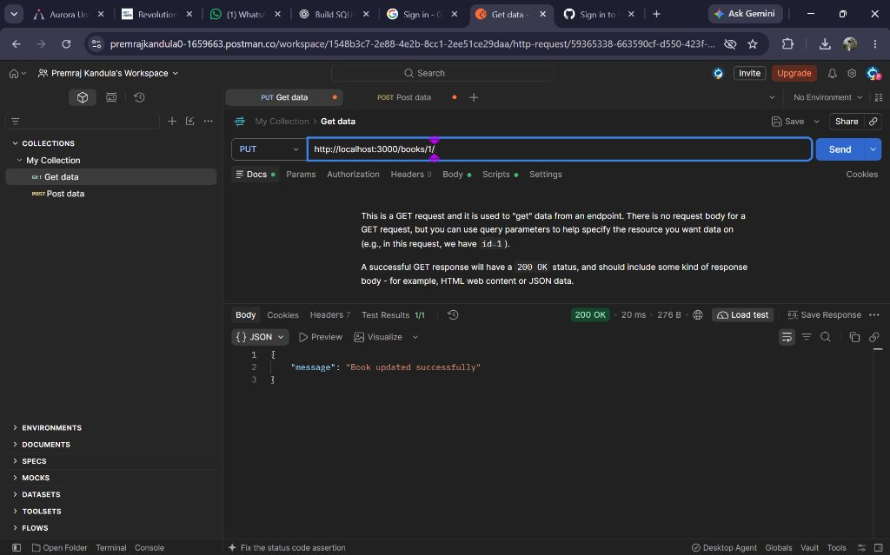
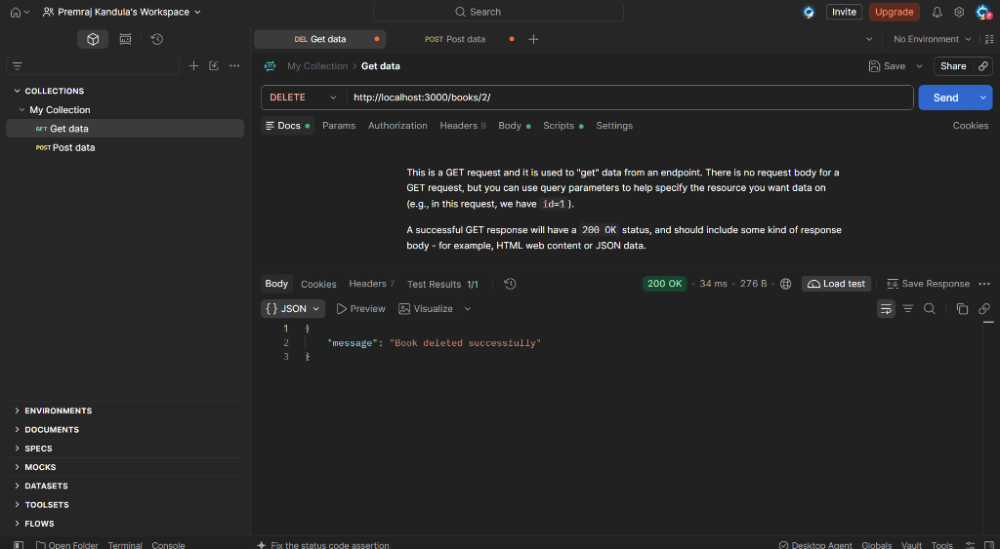
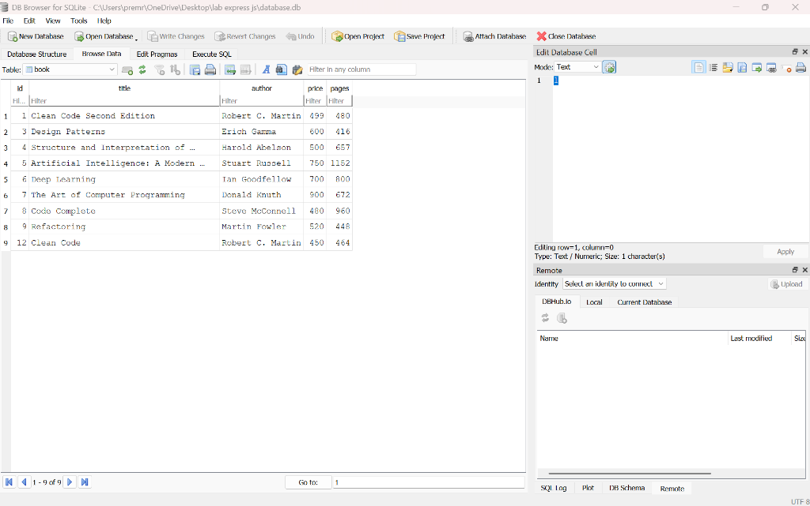

# Lab Report 2 – SQLite Database and CRUD Routes Using Node.js and Express

## 📋 Student Information

| Field | Details |
|-------|---------|
| **Student Name** | Kandula Prem Sai |
| **Registration Number** | N25H03A1356 |
| **Course** | CSE – Gen AI |
| **College** | NIAT |

---

## 📖 Project Overview

This project is a RESTful API backend built with **Node.js** and **Express.js**, connected to an **SQLite** database. It implements complete **CRUD (Create, Read, Update, Delete)** operations for managing a collection of books. The API follows REST conventions with proper HTTP status codes, parameterized SQL queries, and comprehensive error handling.

---

## 🎯 Objectives

- Set up a Node.js project with Express.js framework
- Create and connect to an SQLite database
- Design a relational database schema for books
- Implement all five CRUD API endpoints
- Use parameterized queries to prevent SQL injection
- Handle errors gracefully with appropriate HTTP status codes
- Test all endpoints and verify database operations

---

## 🛠️ Technology Stack

| Technology | Purpose |
|-----------|---------|
| **Node.js** | Runtime environment |
| **Express.js** | Web framework for building REST APIs |
| **SQLite** | Lightweight relational database |
| **sqlite3** | SQLite driver for Node.js |
| **sqlite** | Promise-based SQLite wrapper |
| **Nodemon** | Auto-restart during development |
| **Postman** | API testing tool |

---

## 🗄️ Database Schema

**Database File:** `database.db`

**Table:** `book`

| Column | Type | Constraints |
|--------|------|-------------|
| `id` | INTEGER | PRIMARY KEY AUTOINCREMENT |
| `title` | TEXT | NOT NULL |
| `author` | TEXT | NOT NULL |
| `price` | INTEGER | NOT NULL |
| `pages` | INTEGER | NOT NULL |

**Sample Data:** 9 books pre-loaded including classics like *The Pragmatic Programmer*, *Introduction to Algorithms*, *Design Patterns*, and more.

---

## 📦 Installation Instructions

### Prerequisites
- Node.js (v14 or higher)
- npm (Node Package Manager)

### Steps

1. **Clone the repository:**
   ```bash
   git clone https://github.com/<your-username>/lab-report-2.git
   cd lab-report-2
   ```

2. **Install dependencies:**
   ```bash
   npm install
   ```

3. **Start the server:**
   ```bash
   # Production mode
   npm start

   # Development mode (with auto-restart)
   npm run dev
   ```

4. **Verify the server is running:**
   Open your browser and visit: `http://localhost:3000/books/`

---

## 🚀 How to Run the Application

```bash
# Start in production mode
npm start

# Start in development mode (auto-restarts on file changes)
npm run dev
```

The server starts on **port 3000** by default.

**Console output on successful startup:**
```
Database initialized with sample data.
Server running at http://localhost:3000/
```

---

## 📡 API Endpoint Documentation

### 1. GET `/books/` – Retrieve All Books

**Request:**
```
GET http://localhost:3000/books/
```

**Response (200 OK):**
```json
[
  {
    "id": 1,
    "title": "The Pragmatic Programmer",
    "author": "Andrew Hunt",
    "price": 550,
    "pages": 352
  },
  {
    "id": 2,
    "title": "Introduction to Algorithms",
    "author": "Thomas H. Cormen",
    "price": 800,
    "pages": 1312
  }
]
```

---

### 2. GET `/books/:bookId/` – Retrieve a Book by ID

**Request:**
```
GET http://localhost:3000/books/1/
```

**Response (200 OK):**
```json
{
  "id": 1,
  "title": "The Pragmatic Programmer",
  "author": "Andrew Hunt",
  "price": 550,
  "pages": 352
}
```

**Response (404 Not Found):**
```json
{
  "error": "Book not found"
}
```

---

### 3. POST `/books/` – Add a New Book

**Request:**
```
POST http://localhost:3000/books/
Content-Type: application/json
```

**Request Body:**
```json
{
  "title": "Clean Code",
  "author": "Robert C. Martin",
  "price": 450,
  "pages": 464
}
```

**Response (201 Created):**
```json
{
  "message": "Book added successfully",
  "bookId": 10
}
```

**Response (400 Bad Request) – Missing fields:**
```json
{
  "error": "All fields are required: title, author, price, pages"
}
```

---

### 4. PUT `/books/:bookId/` – Update an Existing Book

**Request:**
```
PUT http://localhost:3000/books/10/
Content-Type: application/json
```

**Request Body:**
```json
{
  "title": "Clean Code Second Edition",
  "author": "Robert C. Martin",
  "price": 499,
  "pages": 480
}
```

**Response (200 OK):**
```json
{
  "message": "Book updated successfully"
}
```

**Response (404 Not Found):**
```json
{
  "error": "Book not found"
}
```

---

### 5. DELETE `/books/:bookId/` – Delete a Book

**Request:**
```
DELETE http://localhost:3000/books/10/
```

**Response (200 OK):**
```json
{
  "message": "Book deleted successfully"
}
```

**Response (404 Not Found):**
```json
{
  "error": "Book not found"
}
```

---

## 🧪 Testing Results

All five CRUD endpoints were executed and tested using **Postman**, with changes verified in **DB Browser for SQLite**:

| # | Operation | Endpoint | Method | Status Code | Verification Result |
|---|---|---|---|---|---|
| 1 | **Retrieve All Books** | `/books/` | `GET` | `200 OK` | ✅ Retrieved all books from database |
| 2 | **Retrieve Book by ID** | `/books/1/` | `GET` | `200 OK` | ✅ Retrieved *The Pragmatic Programmer* (ID: 1) |
| 3 | **Add New Book** | `/books/` | `POST` | `201 Created` | ✅ Inserted *Clean Code* by Robert C. Martin (`bookId: 12`) |
| 4 | **Update Book** | `/books/1/` | `PUT` | `200 OK` | ✅ Updated ID 1 to *Clean Code Second Edition* (₹499, 480 pages) |
| 5 | **Delete Book** | `/books/2/` | `DELETE` | `200 OK` | ✅ Deleted ID 2 (*Introduction to Algorithms*) |
| 6 | **Database Verification** | `database.db` | `SQL` | `Verified` | ✅ Confirmed in DB Browser for SQLite (ID 1 updated, ID 2 removed, ID 12 added) |

### Test Data Used

**POST (Add Book):**
```json
{
  "title": "Clean Code",
  "author": "Robert C. Martin",
  "price": 450,
  "pages": 464
}
```

**PUT (Update Book):**
```json
{
  "title": "Clean Code Second Edition",
  "author": "Robert C. Martin",
  "price": 499,
  "pages": 480
}
```

---

## 📸 Screenshots & API Verification

### 1. GET `/books/` – Retrieve All Books
> **Description:** Fetches the complete list of books stored in the SQLite database.
> **Status:** `200 OK`



---

### 2. GET `/books/:bookId/` – Retrieve Book by ID
> **Description:** Retrieves details of a specific book by ID (`/books/1/`).
> **Status:** `200 OK`



---

### 3. POST `/books/` – Add New Book
> **Description:** Inserts a new book (*Clean Code*) into the database using JSON payload.
> **Status:** `201 Created` | Returned `bookId: 12`



---

### 4. PUT `/books/:bookId/` – Update Book
> **Description:** Updates the book details of ID 1 to *Clean Code Second Edition* (Price: ₹499, Pages: 480).
> **Status:** `200 OK` | Message: *"Book updated successfully"*



---

### 5. DELETE `/books/:bookId/` – Delete Book
> **Description:** Deletes book ID 2 (*Introduction to Algorithms*) from the SQLite database.
> **Status:** `200 OK` | Message: *"Book deleted successfully"*



---

### 6. SQLite Database Verification (DB Browser for SQLite)
> **Description:** Visual verification using **DB Browser for SQLite** confirming the exact state of `database.db` after all CRUD operations:
> - **ID 1** updated to *"Clean Code Second Edition"* (PUT verified)
> - **ID 2** permanently removed (DELETE verified)
> - **ID 12** inserted as *"Clean Code"* (POST verified)
> - Total records: 9



---

## 📁 Project Structure

```
lab-report-2/
├── app.js              # Main Express server with CRUD routes
├── database.db         # SQLite database file
├── initDB.sql          # SQL script for table creation and seed data
├── package.json        # Project metadata and dependencies
├── package-lock.json   # Dependency lock file
├── README.md           # Project documentation
└── screenshots/        # API testing screenshots
    ├── get-all-books.png
    ├── get-book-by-id.png
    ├── post-add-book.png
    ├── put-update-book.png
    ├── delete-book.png
    └── database-verification.png
```

---

## 📄 License

This project is part of an academic lab assignment at **NIAT** for the **CSE – Gen AI** course.

---

*Developed by **Kandula Prem Sai** (N25H03A1356)*

